<a name="english"></a>
<p align="center"><b>English</b> · <a href="#zh">简体中文</a></p>

<div align="center">

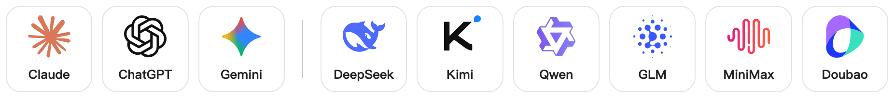

# Anew 知新

### Read with AI in the margins.

**You highlight and argue with the text. The AI fact-checks you and rewrites your notes, right in the files.**
**No chat log to scroll back through. Just a note that gets better every time you read.**

macOS · any AI agent that can edit files (Claude Code by default; [DeepSeek, Kimi, Qwen… work too](#use-any-ai)) · plain Markdown · MIT


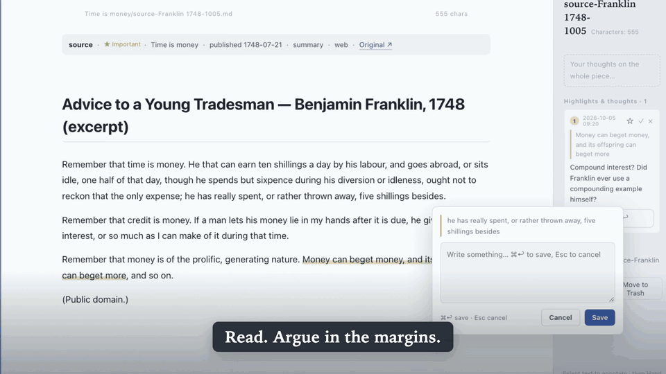

<!-- TODO: full 48s video — drag media/out/anew-promo-small.mp4 into this README on github.com to get a playable link, then paste it here -->

</div>

---

## A chat ends. A note grows.

You've probably done this: paste an article into a chatbot, ask good questions, get good answers… and a week later all you have is a long chat you'll never scroll through again.

Anew works the other way around. You read the way you always have: pen in hand, scribbling in the margins. When you're done, one click hands your margin notes to the AI. It doesn't reply in a chat. It **edits your note**:

```markdown
## 4. The $5 day was buying stability, not PR

> "it had been necessary to hire at the rate of about 53,000 a year
> in order to keep a constant force of 14,000" —— Ford, 1922

👩 Version 2 said PR stunt. I changed my mind: hiring 53,000 people a year
to keep 14,000 is chaos. The $5 was the price of keeping them.

> [!claude]
> That reading fits the numbers he gives. But it wasn't $5 for everyone:
> it was wage plus a profit share, after six months, for workers who met
> the company's conditions. And the 53,000 comes only from Ford himself.
```

👩 is you, in your own words, never rewritten. `[!claude]` is the AI (the name is just the file format, whichever model you use): checking your facts, adding what you missed, pushing back when you're wrong (and saying so when you're right). Read more, annotate again, and the note gets another version. You can watch your own thinking change.

I built it to read long interviews and company materials. In the first week I wrote around 500 study notes with it, and all of them are still in my notes, none lost in a chat.

## The whole loop, with a real example

The example library that ships with the app contains a small research report: **"Model T: how did Ford make a car everyone could buy?"** It was written over three days from two public-domain books, Henry Ford's *My Life and Work* (1922) and Frederick Taylor's *The Principles of Scientific Management* (1911). Here is how it got made, step by step. You can open every file mentioned below.

### 1. Collect the sources

A topic is a folder. Sources go into it as Markdown files, three ways:

- **Ask the AI:** "Find sources on the Model T and the $5 day." It searches, saves the important ones in full (others as summaries), fills in the publication date, and tells you which to read first.
- **Clip from the web:** with the Chrome extension, highlight a sentence on any page. The page is saved into your library as a source (full text via Readability), and your highlights come along as annotations.
- **Paste a link in the app:** **＋ → Save a source**. Anew copies a one-line prompt; your AI agent fetches the page and fills the file.

In the example, the Model T folder has two sources: Ford's chapters on the one-model decision, the moving line, wages and pricing, and Taylor's pig-iron chapter.

### 2. Read and annotate

Select a sentence, click **＋ Annotate**, write what you think: a question, a doubt, a sum, half a sentence. Rough is fine; you're writing to yourself.

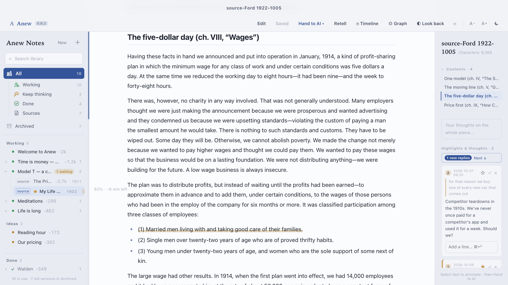

Ford's source has 11 annotations. Some are questions (*"Who checked whether you 'take good care' of your family?"*), some are maths (*"price −62%, output ×42"*), some are just reactions. Click ☆ on the ones you want to keep thinking about. Done reading? Hit **Retell** 🎙 and explain the whole thing out loud; that goes in as one long annotation.

### 3. Hand it to the AI

**Hand to AI ▾** (top right) → **Process annotations**. Anew copies one line, like `Process annotations: …/Model T/source-Ford 1922-1005.md (2 waiting)`. Paste it into your AI agent: Claude Code, or Claude Code running DeepSeek, or Codex, Gemini CLI… (see [Use any AI](#use-any-ai)).

That's the only handoff. The app never calls a model, and the AI never talks to the app: they meet in the files.

### 4. The AI rewrites the note

The AI reads every open annotation and **improves the note's body** instead of replying in a chat:

- your own words go under 👩, unchanged;
- its fact-checks, additions and disagreements go in `> [!claude]` cards;
- the previous version is kept as `old-…md`;
- each annotation is marked handled, with where it went (*"Improved the note: section 4"*);
- the note's properties record the version, its main points, and one line on what changed.

Anew notices the change within 1.5 seconds and shows you what moved. A badge in the sidebar tells you which notes have new edits or replies.

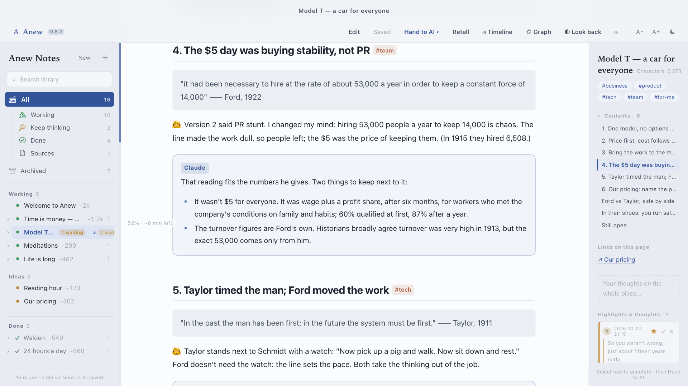

The `anew` skill tells the AI to check, not to agree. In the example it catches that Ford's famous *"any colour… so long as it is black"* is dated 1909 in his book, but black-only is usually dated to about 1914–1925; and it warns that Taylor's pig-iron story is Taylor's own retelling. It never writes your opinions for you, and never invents a quote or a date.

### 5. Go around again

Each round of reading and annotating makes a new version. You can also annotate the AI's cards (*"Good catch. Keep this."*) and ask for more:

- **Put me in their shoes:** the AI gives you only what people knew at the time (*"It's 1909, you run sales at Ford. Do you back one model, or argue for a range?"*), waits for your answer, then tells you what happened.
- **Compare:** a side-by-side table (Taylor 1911 vs Ford 1922: what changed, what didn't), one line per row, for you to annotate.
- **Collect web annotations / Rebuild:** after a pile of further reading, fold it in and rebuild the note around what you now think.

The Model T report went: **v1** "it was the assembly line" → **v2** "price came first; the $5 day was a PR stunt" → **v3** "the $5 day was buying stability" (after seeing the 53,000 figure) + Taylor → **v4** retold out loud, plus what it means for the reader's own pricing.

### 6. See how your thinking changed

**◎ Graph → Topic** draws every version as a column and every point as a line: which ones appeared, which were dropped, which merged.

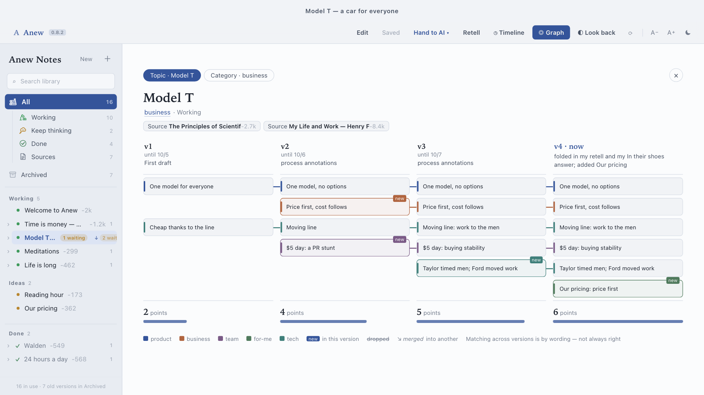

**◎ Graph → Category** shows a whole category of reading (say, everything tagged *time*) and which points flow into your own projects.

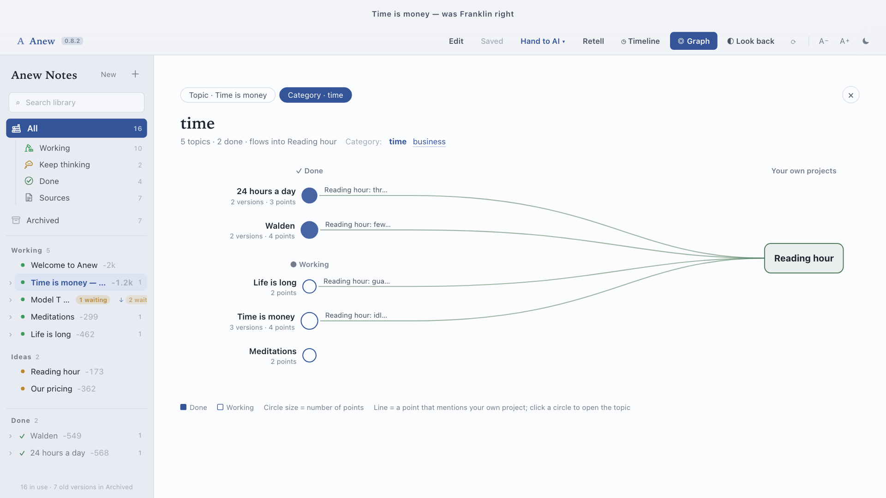

**◷ Timeline** shows a day of reading: which documents you annotated, when, and when the AI answered.

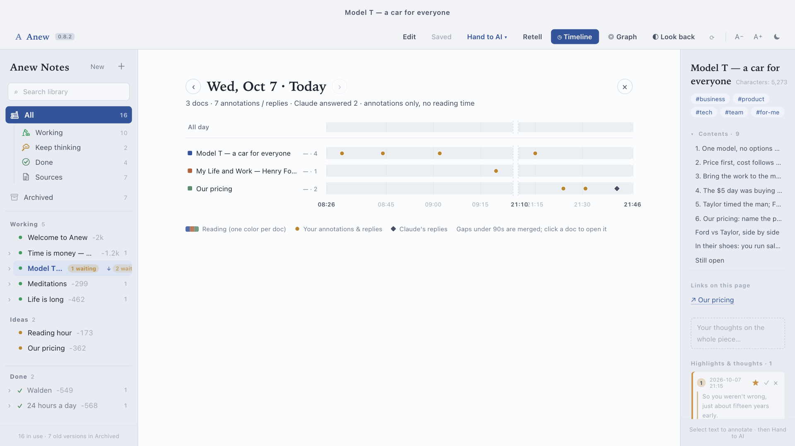

## What it's good for

Anew is for reading where **the point is a conclusion you can defend**, built up over several sittings.

- **Research reports.** A question, a handful of primary sources, a note that has to hold up. Company and product research, a market or a technology, a historical case like the Model T. Every claim in the note sits next to its quote; the AI says when something rests on a single source or couldn't be verified; open questions stay in the note instead of getting lost.
- **Studying a company or a founder.** Long interviews, letters to shareholders, old pitch decks, read in date order. *In their shoes* is built for this: decide with what they knew, then see what happened.
- **Literature reviews and learning a field.** Several papers per topic, a comparison table, a note per topic that keeps improving as you read more.
- **Books you want to keep.** One note per book that grows with every rereading, instead of highlights you never open again.
- **Decisions of your own.** Mark a note as *keep-thinking* (like *Our pricing* in the example), and the graph shows which of your reading feeds into it.

It's probably **not** for quick lookups (just ask an AI), live team editing, or reading on your phone.

**Who tends to like it:** you read to think, not to collect; you already use an AI and wish its best answers didn't vanish into chat history; you like your files on your own disk, as Markdown you can open in Obsidian, grep, or put in git.

## Things you can say to the AI

Anew copies the prompt for you. You can also just type it into your AI agent.

| Say | What happens |
| --- | --- |
| **Process annotations** | Your margin notes get folded into the note. Your words stay yours; the AI's additions and pushback go in cards. The old version is kept. |
| **Retell** 🎙 | Hit the mic and explain the whole piece out loud, rambling welcome. The AI turns it into a structured note. |
| **Put me in their shoes** | The AI gives you only what *they* knew back then (say, 1909) and asks: *would you invest? build it? which one?* It won't tell you what happened until you've answered. |
| **Compare** | A side-by-side table, A / B / what changed / what didn't, one line per row, for you to annotate. |
| **Rebuild** | After a pile of further reading, the AI rebuilds the note around what *you* now think. |
| **Look back** ◐ | Starting from what you read in the last three days, the AI digs up older things in your library: two related, one that argues against you, one at random. |
| **Find sources on…** | The AI goes looking, saves the important ones in full, and tells you what to read first. |

## Use any AI

The button says **Hand to AI**, not "hand to Claude". Anew only writes files and copies a one-line prompt, so any AI agent that can read and write files on your Mac can do the other half. Claude Code is the default and the most tested; it also runs other companies' models.

**Example: DeepSeek.** DeepSeek offers an Anthropic-compatible API, so Claude Code can run on DeepSeek's model ([DeepSeek's guide](https://api-docs.deepseek.com/guides/coding_agents)):

```bash
export ANTHROPIC_BASE_URL=https://api.deepseek.com/anthropic
export ANTHROPIC_AUTH_TOKEN=<your DeepSeek API key>
export ANTHROPIC_MODEL=deepseek-flash
claude
```

Install the skill as below, click **Hand to AI ▾**, paste. Same loop, same files, DeepSeek doing the reading.

**Other models.** Kimi, Qwen, GLM, MiniMax, Doubao and others can be used the same way if your provider offers an Anthropic-compatible endpoint (check its docs for the URL and model name). Or use a provider's own agent, such as OpenAI's Codex CLI, Google's Gemini CLI or Qwen Code: put the rules from [`skill/anew/SKILL.md`](skill/anew/SKILL.md) in its instructions file (`AGENTS.md` for Codex, `GEMINI.md` for Gemini CLI), or start with "Read skill/anew/SKILL.md and follow it for my Anew library."

How well it goes depends on the model: the rules ask it to fact-check you, keep your words untouched and never invent quotes, and stronger models follow them better.

## Why it's built this way

- **The app never calls a model.** No API key in the app, no server, no account. Use whichever AI you already pay for.
- **The AI never talks to the app.** They meet in the files: the AI edits them, Anew notices within 1.5 seconds and refreshes.
- **Your words are sacred.** The skill tells the AI never to write "my thoughts" for you, never to invent a quote or a date, and to say so when it couldn't verify something.
- **Nothing is lost.** Every rewrite keeps the old version, and the app keeps an edit history.

## What's in the box

| | |
| --- | --- |
| **Mac app** (`native/`) | Swift + WKWebView, ~7k lines, zero dependencies. Library sidebar by topic; read / edit / annotate; auto-save; version history; graph and timeline. |
| **Chrome extension** (`chrome/`) | Highlight on any page → saved as a source (summary or full text via Readability), highlights become annotations. Native messaging writes straight into your library. |
| **AI skill** (`skill/anew/`) | Teaches the AI the file layout, the annotation format, and every prompt above, in English or Chinese. |
| **Example library** (`example-library/en`, `zh`) | Copied to `~/Documents/Anew Notes` on first launch, in your system language: the Model T research report (2 sources, 4 versions, 19 annotations), five short classics on time, and two "own projects" the reading feeds into. |

## Install

You'll need macOS 13 or later (Apple silicon or Intel) and an AI agent that can read and write files: [Claude Code](https://claude.com/claude-code) by default, with any model (see [Use any AI](#use-any-ai)).

**1. Download the app.** Get **[Anew-0.8.2.dmg](https://github.com/daisycao/anew/releases/latest)** from Releases, open it, and drag **Anew** into Applications.

The app isn't signed with an Apple developer certificate yet, so the first time macOS will say it can't verify the developer. Click **Done**, then go to **System Settings → Privacy & Security**, scroll down and click **Open Anyway**. You only do this once. (Or run `xattr -dr com.apple.quarantine "/Applications/知新 Anew.app"` in Terminal.)

**2. Teach your AI how to work with your library** (for Claude Code; for other agents see [Use any AI](#use-any-ai)):

```bash
mkdir -p ~/.claude/skills/anew && curl -fsSL https://raw.githubusercontent.com/daisycao/anew/main/skill/anew/SKILL.md -o ~/.claude/skills/anew/SKILL.md
```

**Build from source instead** (needs Xcode Command Line Tools, `xcode-select --install`):

```bash
git clone https://github.com/daisycao/anew.git
cd anew
zsh native/build-app.sh
open "outputs/知新 Anew.app"
```

**Optional, the Chrome extension** (needs the cloned repo and Node.js):

1. Double-click `chrome/install-extension.command` (registers the native host that writes into your library).
2. Open `chrome://extensions`, turn on **Developer mode**, click **Load unpacked**, pick the `chrome/` folder.

## Try it in two minutes

1. Open Anew. The example library is already there. Start with **Welcome**, then **Model T**.
2. Open the source **Ford 1922**, select a sentence → **＋ Annotate** → write what you think, even one line.
3. **Hand to AI ▾** (top right) → **Process annotations** → paste into your AI agent.
4. Watch the report turn into version 5. Your line is under 👩; the AI's answer is in a card next to it. Open **◎ Graph** to see the new column.

Then point it at your own reading: **File → Open Library…** (⇧⌘O) opens any folder of Markdown. An Obsidian vault works.

## How it works

```
Anew Notes/
  Model T/
    source-Ford 1922-1005.md            ← a source (read-only in the app)
    source-Taylor 1911-1006.md
    Model T — a car for everyone.md     ← your note, rewritten with the AI (v4)
    old-retell-1007.md                  ← v3, kept when the AI rewrote it
    old-process annotations-1006.md     ← v2
    old-process annotations-1005.md     ← v1
  Our pricing/Our pricing.md            ← your own project (type: keep-thinking)
  .paper-md-notes/<base64 path>.json    ← annotations + reply threads
  .paper-md-history/…                   ← edit history
~/.anew/library                         ← which folder is your library (shared by app, extension, skill)
```

Notes carry Obsidian-compatible YAML properties (`type`, `stage`, `sources`, `version`, `points`, `changed`…); the graph is drawn from `points` across versions. Annotations live next to the Markdown, never inside it, so your text stays clean. The full format is in [`skill/anew/SKILL.md`](skill/anew/SKILL.md).

## Status

A personal tool, used daily since September 2026, now shared. Honest caveats:

- **Mac only.** Not signed with an Apple developer certificate or notarized yet: the first open needs **Open Anyway** (see [Install](#install)).
- **English and Chinese.** The app, extension and example library follow your system language; the skill writes in your library's language.
- **Timeline reading time** (how long you spent on each document) comes from a separate time tracker of mine and isn't included; without it the timeline shows annotations and replies only.
- Built on an earlier reader of mine, Paper MD, so you'll see `paper-md` in a few file names.

Issues and ideas welcome. Especially: what did you read with it?

## License

MIT. `chrome/lib/` bundles Mozilla Readability (Apache 2.0) and Turndown (MIT). The example library quotes public-domain texts from Project Gutenberg and Wikisource.

---

<a name="zh"></a>
<p align="center"><a href="#english">English</a> · <b>简体中文</b></p>

<div align="center">


# 知新 Anew

### 和 AI 一起读，它在页边回你。

**你划线、批注、和原文较劲；AI 帮你查证，把笔记改好，直接改在文件里。**
**不留一长串聊天记录，只留一篇越读越好的笔记。**

macOS · 任何能改文件的 AI 助手（默认 Claude Code；[DeepSeek、Kimi、千问……也行](#哪家-ai-都能用)） · 纯 Markdown · MIT


<!-- TODO: 演示 GIF（约 15 秒）：选中一句 → 写个想法 → 交给 AI → 贴进 AI → 笔记自己改好 -->

</div>

---

## 聊天会结束，笔记会长大

你多半这样做过：把一篇文章丢给 AI，问了一堆好问题，也拿到了好回答……一周后，手上只剩一长串再也不会翻回去的对话。

Anew 反过来。你照平常那样读：拿着笔，在页边写想法。读完点一下，把页边的批注交给 AI。它不在对话框里回你，而是**直接改你的笔记**：

```markdown
## 4. 5 美元日薪：不是作秀，是在买稳定

> "it had been necessary to hire at the rate of about 53,000 a year
> in order to keep a constant force of 14,000" —— Ford, 1922

👩 第 2 版我写的是作秀。改主意了：为了维持 14,000 人一年招 53,000 人，
这是一团乱。5 美元是留住他们的价钱。

> [!claude]
> 按他给的数字，这个理解站得住。但不是人人都拿 5 美元：它是工资加分红，
> 干满六个月、符合公司的条件才有。而且「53,000」只有福特一家的说法。
```

👩 是你，原话照留，AI 不替你改。`[!claude]` 是 AI（不管用哪家模型，文件里都这么写）：查你的事实，补你漏的，你错了它反驳，你对了它也会直说。再读、再批注，笔记就多一版。你能看到自己的想法是怎么变的。

我做它是为了读长访谈和公司资料。第一周用它写了大约 500 条学习笔记，全都留在自己的笔记里，没有一条沉在聊天记录里。

## 一整圈怎么走：拿一个真例子说

App 自带的示例库里有一篇小研究报告：**《T 型车：福特是怎么做出一辆人人买得起的车的？》**。它是三天里用两本公版书写出来的：福特的自传《我的生活与工作》（1922）和泰勒的《科学管理原理》（1911）。下面一步一步讲它是怎么来的，提到的每个文件你都能打开看。

### 1. 收来源

一个主题就是一个文件夹，来源是里面的 Markdown 文件。三种进法：

- **让 AI 去找：**「去找来源：T 型车和 5 美元日薪」。AI 自己搜，重要的存全文、其余存摘要，填好原文发表日期，告诉你先读哪几篇。
- **网页上划线：**装了 Chrome 插件，在任何网页上划一句，整页就存进库里当来源（用 Readability 抓全文），你划的句子变成批注。
- **在 App 里贴网址：**「＋ → 存一篇来源」。Anew 复制好一句话，贴进你的 AI，它去把原文抓下来填进文件。

示例里，「T 型车」文件夹有两篇来源：福特讲只做一种车、流水线、工资和定价的几章，和泰勒搬生铁那一章。

### 2. 读、划线、批注

选中一句，点「＋ 划线」，写下你在想什么：一个问题、一点怀疑、一笔账、半句话都行。写给自己看的，不用写得好。

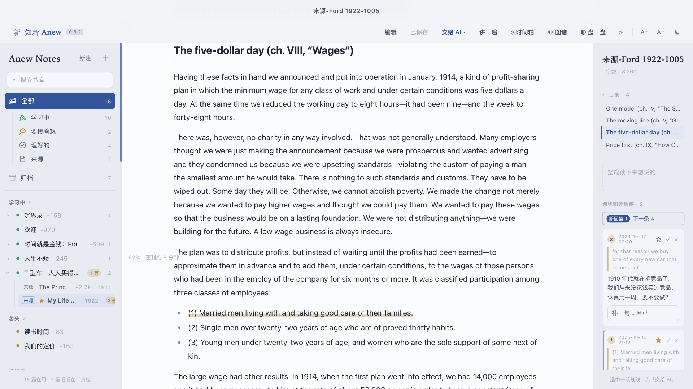

福特那篇有 11 条批注。有的是问题（「谁来检查你有没有『好好照顾家庭』？」），有的是算账（「价格 −62%，产量 ×42」），有的只是一句反应。想接着琢磨的点 ☆。读完了，点「讲一遍」🎙，用嘴把整件事讲一遍，它会作为一条长批注存下来。

### 3. 交给 AI

右上角「交给 AI ▾」→「处理这篇的回响」。Anew 复制好一句话，比如 `处理下批注：…/T 型车/来源-Ford 1922-1005.md（2 条等你回）`，贴进你的 AI：Claude Code，或者接了 DeepSeek 的 Claude Code，或者 Codex、Gemini CLI……（见[哪家 AI 都能用](#哪家-ai-都能用)）。

只交接这一下。App 从不调模型，AI 也不跟 App 通信：它们在文件里碰头。

### 4. AI 改笔记

AI 读完所有没处理的批注，**改的是笔记正文**，不是在对话框里回你：

- 你自己的话放在 👩 下面，一个字不改；
- 它的查证、补充和不同意见放在 `> [!claude]` 卡片里；
- 上一版留成「旧版-…md」；
- 每条批注标成已处理，写明去了哪（「已改进正文：第 4 块」）；
- 笔记属性里记下版本号、这一版的几个观点、一句话说改了什么。

Anew 1.5 秒内发现改动，标出哪里变了。左边栏的小标告诉你哪几篇有新改动、新回复。

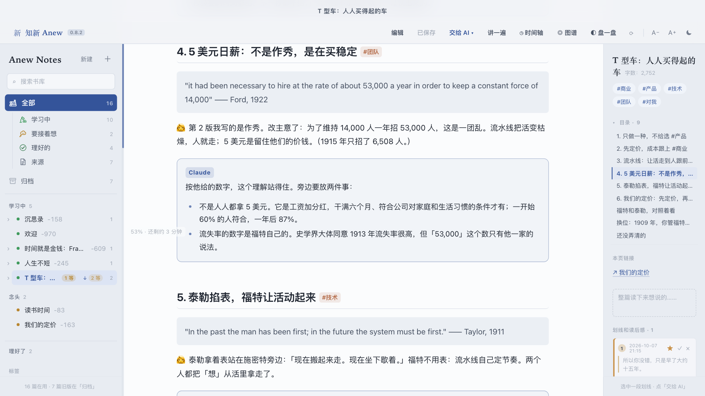

`anew` skill 要求 AI 去核对，而不是附和。示例里它指出：福特那句「任何颜色都行，只要是黑色」在书里说是 1909 年，但「只有黑色」通常认为是约 1914–1925 年的事；它也提醒，泰勒搬生铁的故事是泰勒自己转述的。它从不替你写「我的想法」，也不编引文和日期。

### 5. 再来一圈

每读一轮、批注一轮，就多一版。你也可以在 AI 的卡片上批注（「抓得好，留着」），还可以让它：

- **换位：**只给你当时的人能知道的信息（「1909 年，你管福特的销售。支持只做一种车，还是主张做一个车型系列？」），等你答了，再告诉你后来怎样了。
- **对照：**一张对照表（泰勒 1911 vs 福特 1922：变了什么、没变什么），一行一句，留给你批注。
- **收一下网页批注 / 重整一遍：**补充读了一堆以后，收进来，再按你现在的看法把笔记重搭一遍。

T 型车这篇是这样走的：**第 1 版**「靠流水线」→ **第 2 版**「价格在前；5 美元日薪是作秀」→ **第 3 版**看到 53,000 这个数，改成「5 美元日薪是在买稳定」，加了泰勒 → **第 4 版**用嘴讲了一遍，又想到对自己定价的启发。

### 6. 看自己的想法怎么变的

「◎ 图谱 → 主题」把每一版画成一列、每个观点画成一行：哪些是新冒出来的、哪些删了、哪些并进了别的。

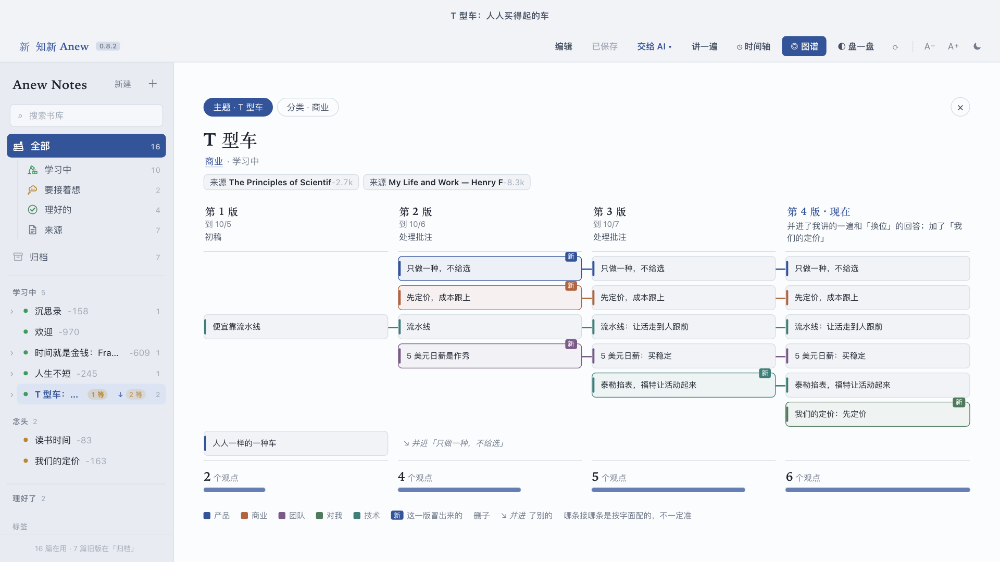

「◎ 图谱 → 分类」看一整类阅读（比如所有打了「时间」标签的），以及哪些观点流进了你自己的事。

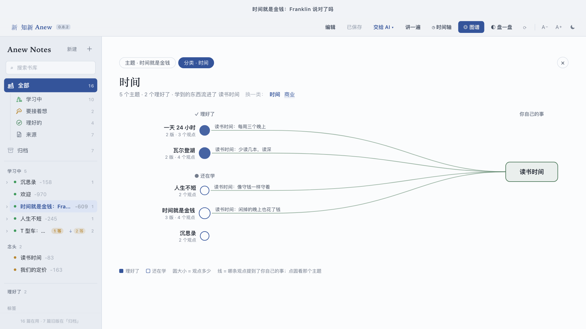

「◷ 时间轴」看某一天：批注了哪几篇、几点写的、AI 几点回的。

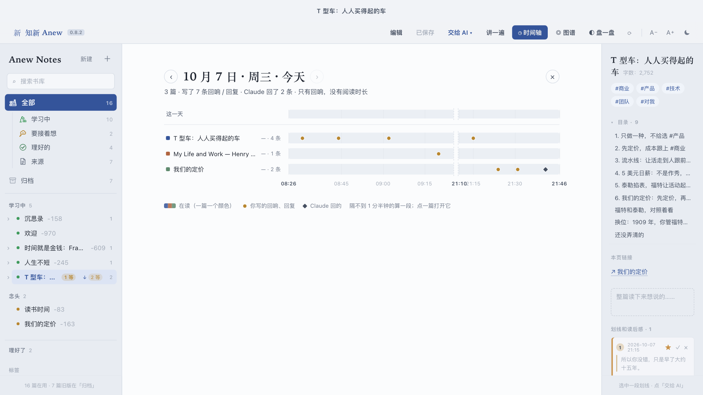

## 适合做什么

Anew 适合那种**要读出一个站得住的结论、而且要分好几次读完**的事。

- **研究报告。** 一个问题，几篇一手来源，一篇要经得起追问的笔记。公司和产品研究、一个市场或一项技术、一个像 T 型车这样的历史案例。笔记里每个判断旁边都有原文；只靠一个来源、或者核实不了的，AI 会直说；没弄清的问题留在笔记里，不会丢。
- **研究一家公司、一个创始人。** 长访谈、致股东信、老 BP，按时间顺着读。「换位」就是为这个做的：先用他们当时知道的做决定，再看后来怎样。
- **文献综述、入门一个领域。** 一个主题几篇论文，一张对照表，一篇随着越读越多不断改进的笔记。
- **想留下来的书。** 一本书一篇笔记，每重读一次就长一点，而不是一堆再也不会打开的划线。
- **自己要做的决定。** 把一篇笔记标成「要接着想」（像示例里的「我们的定价」），图谱会画出你读的哪些东西流到了它。

大概**不适合**：查个事实（直接问 AI 就行）、多人实时协作、在手机上读。

**谁会喜欢：**读东西是为了想清楚，不是为了收藏；已经在用 AI，又可惜它最好的回答都沉在聊天记录里；喜欢文件在自己硬盘上，是 Markdown，Obsidian 能开，能搜，能放进 git。

## 你可以对 AI 说

Anew 会帮你把这句话复制好；你也可以直接在你的 AI 里打。

| 说 | 会发生什么 |
| --- | --- |
| **处理下批注** | 你的批注并进笔记正文。你的话原样保留，AI 的补充和反驳放在卡片里，旧版自动留底。 |
| **讲一遍** 🎙 | 点话筒，把整篇用自己的话讲一遍，啰嗦也没关系。AI 帮你理成一篇有结构的笔记。 |
| **换位** | AI 只给你当时的人能知道的信息（比如 1909 年），然后问你：投不投？做不做？选哪个？你答了，它才告诉你后来怎样了。 |
| **对照** | 一张对照表：A / B / 变了什么 / 没变什么，一行一句，留给你批注。 |
| **重整一遍** | 补充读了一堆以后，AI 按你现在的看法把笔记的骨架重搭一遍。 |
| **盘一盘** ◐ | 从你最近三天读的东西出发，去库里翻旧材料：两条相关的、一条唱反调的、一条随机的。 |
| **去找来源** | AI 自己去找，重要的存全文，告诉你先读哪几篇。 |

## 哪家 AI 都能用

按钮叫「交给 AI」，不叫「交给 Claude」。Anew 只管写文件、复制一句话，另一半谁来做都行：只要是能在你 Mac 上读写文件的 AI 助手。默认用 Claude Code，测得最多；它也能接别家的模型。

**举个例子：DeepSeek。** DeepSeek 提供兼容 Anthropic 的接口，Claude Code 可以直接跑在 DeepSeek 的模型上（[DeepSeek 官方说明](https://api-docs.deepseek.com/zh-cn/guides/coding_agents)）：

```bash
export ANTHROPIC_BASE_URL=https://api.deepseek.com/anthropic
export ANTHROPIC_AUTH_TOKEN=<你的 DeepSeek API key>
export ANTHROPIC_MODEL=deepseek-flash
claude
```

照下面装好 skill，点「交给 AI ▾」，贴进去。同一套流程、同一批文件，只是换成 DeepSeek 来读。

**其他模型。** Kimi、通义千问、智谱 GLM、MiniMax、豆包等，只要你用的平台提供兼容 Anthropic 的接口，都可以这样接（地址和模型名看平台文档）。也可以用各家自己的助手，比如 OpenAI 的 Codex CLI、Google 的 Gemini CLI、Qwen Code：把 [`skill/anew/SKILL.md`](skill/anew/SKILL.md) 里的规则放进它的说明文件（Codex 是 `AGENTS.md`，Gemini CLI 是 `GEMINI.md`），或者开头先说一句「读一下 skill/anew/SKILL.md，按它处理我的 Anew 书库」。

效果取决于模型：规则要求它查证你、不改你的原话、不编引文，越强的模型照做得越好。

## 为什么这样做

- **App 从不调模型。** App 里不填 API key、不要服务器、不要注册。你已经在用哪家 AI，就用哪家。
- **AI 也不跟 App 通信。** 它们在文件里碰头：AI 改文件，Anew 1.5 秒内看到并刷新。
- **你的话不能动。** skill 里写死了：AI 不替你写「我的想法」，不编引文和日期，查不到就直说查不到。
- **什么都不丢。** 每次重写都留旧版，App 还有修改历史。

## 里面有什么

| | |
| --- | --- |
| **Mac App**（`native/`） | Swift + WKWebView，约 7 千行，零依赖。按主题分的书库；阅读 / 编辑 / 批注；自动保存；修改历史；图谱和时间轴。 |
| **Chrome 插件**（`chrome/`） | 网页上划一句，这页就存成库里的来源（摘要或用 Readability 抓全文），划线变批注。通过 native messaging 直接写进你的库。 |
| **AI 用的 skill**（`skill/anew/`） | 告诉 AI 文件怎么放、批注什么格式，以及上面每一句话该怎么做；中英文都认。 |
| **示例库**（`example-library/zh`、`en`） | 第一次打开时按系统语言拷到 `~/Documents/Anew Notes`：T 型车研究报告（2 篇来源、4 版、19 条批注）、五篇讲时间的短文，和两件阅读会流进去的「自己的事」。 |

## 安装

需要 macOS 13 以上（Apple 芯片和 Intel 都行），和一个能读写文件的 AI 助手：默认 [Claude Code](https://claude.com/claude-code)，模型随你换（见[哪家 AI 都能用](#哪家-ai-都能用)）。

**1. 下载 App。** 到 Releases 下载 **[Anew-0.8.2.dmg](https://github.com/daisycao/anew/releases/latest)**，打开，把「知新 Anew」拖进「应用程序」。

App 还没有用苹果开发者证书签名，第一次打开时 macOS 会说「无法验证开发者」。点「完成」，然后去 **系统设置 → 隐私与安全性**，往下拉，点 **仍要打开**。只需要做一次。（也可以在终端里跑 `xattr -dr com.apple.quarantine "/Applications/知新 Anew.app"`。）

**2. 让 AI 学会怎么用你的库**（Claude Code 的装法；别的助手见[哪家 AI 都能用](#哪家-ai-都能用)）：

```bash
mkdir -p ~/.claude/skills/anew && curl -fsSL https://raw.githubusercontent.com/daisycao/anew/main/skill/anew/SKILL.md -o ~/.claude/skills/anew/SKILL.md
```

**想自己从源码编译**（需要 Xcode 命令行工具，`xcode-select --install`）：

```bash
git clone https://github.com/daisycao/anew.git
cd anew
zsh native/build-app.sh
open "outputs/知新 Anew.app"
```

**可选，Chrome 插件**（需要先 clone 仓库，并装好 Node.js）：

1. 双击 `chrome/install-extension.command`（注册往你库里写文件的 native host）。
2. 打开 `chrome://extensions`，打开**开发者模式**，点**加载已解压的扩展程序**，选 `chrome/` 文件夹。

## 两分钟试一下

1. 打开 Anew，示例库已经在了。先看「欢迎」，再看「T 型车」。
2. 打开来源「Ford 1922」，选一句 →「＋ 划线」→ 写下你的想法，一句就够。
3. 右上角「交给 AI ▾」→「处理这篇的回响」→ 贴进你的 AI。
4. 看报告变成第 5 版：你那句在 👩 下面，AI 的回答在旁边的卡片里。打开「◎ 图谱」，能看到多出来的那一列。

然后换成你自己要读的东西：**文件 → 打开书库…**（⇧⌘O）能打开任何一个 Markdown 文件夹，Obsidian 的库也行。

## 原理

```
Anew Notes/
  T 型车/
    来源-Ford 1922-1005.md          ← 来源（App 里只读）
    来源-Taylor 1911-1006.md
    T 型车：人人买得起的车.md        ← 你的笔记，和 AI 一起改（第 4 版）
    旧版-讲一遍前-1007.md            ← 第 3 版，AI 改之前留的底
    旧版-处理批注前-1006.md          ← 第 2 版
    旧版-处理批注前-1005.md          ← 第 1 版
  我们的定价/我们的定价.md          ← 你自己的事（type: 要接着想）
  .paper-md-notes/<base64 路径>.json ← 批注和回复
  .paper-md-history/…               ← 修改历史
~/.anew/library                     ← 哪个文件夹是你的库（App、插件、skill 共用）
```

笔记带 Obsidian 兼容的 YAML 属性（`type`、`stage`、`sources`、`version`、`points`、`changed`……），图谱就是按各版的 `points` 画的。批注放在 Markdown 旁边、不写进正文，你的文字保持干净。完整格式见 [`skill/anew/SKILL.md`](skill/anew/SKILL.md)。

## 现状

自己每天在用的工具，从 2026 年 9 月用到现在，拿出来分享。老实说几点：

- **只有 Mac。** 还没用苹果开发者证书签名、没公证：第一次打开要点「仍要打开」（见[安装](#安装)）。
- **中英双语。** App、插件、示例库跟系统语言走；skill 按你库的语言写。
- **时间轴里的阅读时长**（每篇读了多久）来自我另一个记时间的工具，没有包含在这里；没有它，时间轴只画批注和回复。
- 前身是我之前做的阅读器 Paper MD，所以有几个文件名里还带着 `paper-md`。

欢迎提 issue 和想法。最想知道的是：你用它读了什么？

## 许可

MIT。`chrome/lib/` 里打包了 Mozilla Readability（Apache 2.0）和 Turndown（MIT）。示例库引用的是古腾堡计划和维基文库里的公版文本。
